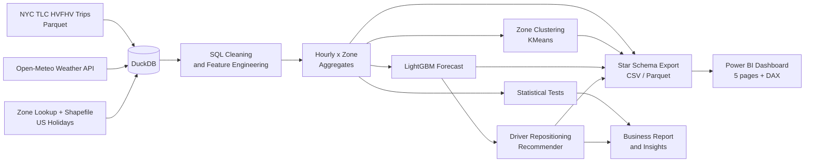
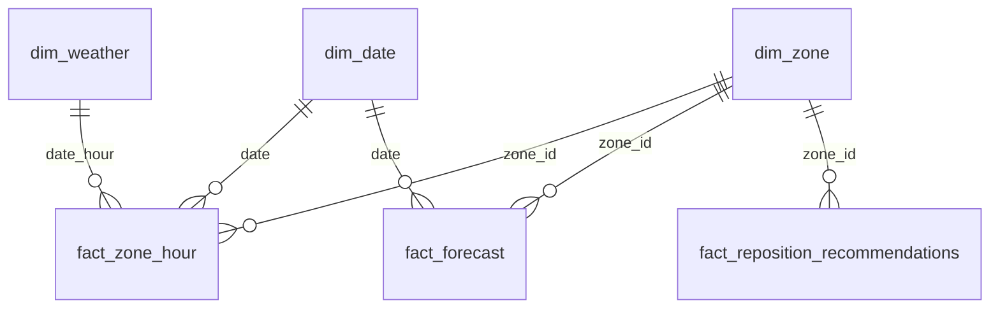

# Predicting Surge Demand and Optimizing Driver Allocation in NYC Ride-Hailing

> End-to-end data analytics project: from 15M+ raw trip records to a demand forecast, statistical findings, and a driver repositioning recommendation, delivered through a 5-page Power BI dashboard.

---

## Table of Contents

1. [Business Problem](#business-problem)
2. [Key Results](#key-results)
3. [Dashboard](#dashboard)
4. [Architecture](#architecture)
5. [Data Sources](#data-sources)
6. [Methodology](#methodology)
7. [Tech Stack](#tech-stack)
8. [Repository Structure](#repository-structure)
9. [How to Run](#how-to-run)
10. [Power BI Assembly](#power-bi-assembly)
11. [Limitations](#limitations)
12. [Next Steps](#next-steps)
13. [Author](#author)

---

## Business Problem

Ride-hailing platforms lose revenue when demand and supply are out of balance: riders wait too long or cancel in high-demand zones, while drivers sit idle in low-demand ones.

This project answers four questions:

1. **Where and when** does demand exceed supply?
2. **What drives** revenue per trip, and which zones are most profitable for drivers and for the platform?
3. **How much** do weather and holidays shift demand?
4. **Where should drivers be repositioned** at a given hour to capture the most uncaptured demand?

---

## Key Results

> Fill these in from the pipeline output (`reports/`, `docs/insights.md`). Do not publish numbers you cannot reproduce.

| Area | Result |
|---|---|
| Data volume | Aggregated **N million trips** to **K rows** before loading into Power BI |
| Cleaning | **X%** of raw rows removed under **Y** documented rules (see `reports/cleaning_log.md`) |
| Demand hotspots | Top surge zones: `TBD` (peak hours: `TBD`) |
| Rain effect | Rain changes hourly demand by **X%** (p = `TBD`, effect size = `TBD`) |
| Holiday effect | Holidays change demand by **X%** (p = `TBD`) |
| Borough comparison | Revenue per trip differs significantly across boroughs (test: `TBD`, p = `TBD`) |
| Zone segments | **K** clusters identified: `TBD` |
| Forecast accuracy | LightGBM MAPE **X%** / WAPE **X%** vs seasonal-naive baseline **Y%** |
| Repositioning impact | Moving **X** drivers per hour could lift completed trips by about **Y%** (range `TBD` to `TBD` in sensitivity analysis) |

Top insights and full write-up: [`docs/insights.md`](docs/insights.md) and [`docs/business_report.md`](docs/business_report.md).

---

## Dashboard

The Power BI dashboard has five pages: Executive Summary, Demand Heatmap, Weather and Holiday Impact, Forecast vs Actual, and Driver Repositioning Simulator.

Walkthrough video: `ADD LINK HERE`

---

## Architecture



**Design choice:** heavy processing (joins, cleaning, aggregation) runs in DuckDB and Python. Power BI only receives aggregated tables, which keeps the dashboard fast and the data model clean.

---

## Data Sources

| Source | Description | Link |
|---|---|---|
| NYC TLC High Volume FHV Trip Records | Uber/Lyft trips, Jan to Mar 2024 (parquet) | https://www.nyc.gov/site/tlc/about/tlc-trip-record-data.page |
| Taxi Zone Lookup and Shapefile | Zone names, boroughs, geometry for centroids | Same TLC page |
| Open-Meteo Historical Weather API | Hourly temperature, precipitation, snowfall for NYC | https://open-meteo.com |
| Python `holidays` package | US federal holiday calendar | https://pypi.org/project/holidays/ |

All data is downloaded automatically by `src/ingest.py`. No manual downloads are needed.

---

## Methodology

### 1. Data Engineering
Raw parquet files are loaded into DuckDB and processed in SQL, so the full dataset is never loaded into pandas.

### 2. Data Quality and Cleaning
Profiled nulls, duplicates, outliers, negative fares, impossible distances, out-of-order timestamps, and unknown zones. Every rule and the number of rows it removed is logged in `reports/cleaning_log.md`. Data-quality checks are automated with `pytest`.

### 3. Feature Engineering
Hour, weekday, weekend flag, holiday flag, rush-hour flag, trip speed, wait time, driver pay, platform take rate, tip percentage, pooled flag, weather (temperature, rain, snow), lag features (1h, 24h, 168h), and rolling averages.

### 4. SQL Analysis
CTEs, window functions (`RANK`, `LAG`, running totals), and multi-table joins to analyze zone rankings, revenue per trip, take rate by borough, peak hours, MoM growth, airport vs non-airport, and driver earnings per hour.

### 5. Exploratory Analysis
Hour-by-weekday heatmaps, borough comparisons, revenue distributions, correlation matrix, and wait-time analysis. Figures live in `reports/figures/`.

### 6. Statistical Testing

| Test | Question |
|---|---|
| Mann-Whitney / t-test | Does rain change hourly demand? |
| Mann-Whitney / t-test | Do weekday and weekend revenue per trip differ? |
| Holiday comparison | Do holidays shift demand? |
| ANOVA / Kruskal-Wallis | Does revenue per trip differ across boroughs? |
| A/B simulation + power analysis | What sample size is needed to detect a repositioning effect? |

Each test reports p-values, effect sizes, confidence intervals, and a plain-English conclusion.

### 7. Zone Segmentation
KMeans clustering on demand, revenue, wait time, and time-of-day profile. Clusters are named by behavior (for example commuter hubs, nightlife, airport, low demand).

### 8. Demand Forecasting
- **Scope:** top 50 zones by volume plus a city-wide model
- **Baselines:** seasonal naive and moving average
- **Model:** LightGBM with lag, weather, and holiday features
- **Validation:** time-based train/validation/test split, no leakage
- **Metrics:** MAE, RMSE, MAPE, WAPE, plus feature importance and residual analysis

### 9. Driver Repositioning Recommender
For each hour, expected demand minus a supply proxy gives a gap score per zone. The recommender allocates a configurable number of drivers (`X`) to the highest-gap zones, estimates uplift in completed trips and revenue under stated assumptions, and includes a sensitivity analysis.

---

## Tech Stack

| Layer | Tools |
|---|---|
| Language | Python 3.11 |
| Data processing | DuckDB, SQL, pandas |
| Statistics | scipy, statsmodels |
| Machine learning | scikit-learn, LightGBM |
| Visualization | matplotlib, seaborn, plotly |
| Testing | pytest |
| BI | Power BI Desktop, DAX |
| Workflow | Make, Jupyter |

---

## Repository Structure

```
project/
├── README.md
├── requirements.txt
├── Makefile
├── data/
│   ├── raw/                  # downloaded source files (gitignored)
│   ├── processed/            # cleaned and aggregated data (gitignored)
│   └── powerbi/              # star-schema exports for Power BI
├── sql/                      # 01_clean, 02_features, 03_aggregates, 04_analysis
├── src/
│   ├── ingest.py
│   ├── clean.py
│   ├── features.py
│   ├── aggregate.py
│   ├── stats_tests.py
│   ├── forecast.py
│   ├── reposition.py
│   ├── export_powerbi.py
│   └── run_pipeline.py
├── notebooks/                # data quality, EDA, hypothesis tests, forecasting
├── powerbi/                  # measures.dax, data_model.md, theme.json, build_guide.md
├── docs/                     # assumptions, data dictionary, business report, insights, interview Q&A
├── reports/
│   ├── figures/
│   └── cleaning_log.md
└── tests/
```

---

## How to Run

**Prerequisites:** Python 3.11+, about 5 GB free disk space, and an internet connection for the first run.

```bash
# 1. Clone the repository
git clone https://github.com/<your-username>/<repo-name>.git
cd <repo-name>

# 2. Create a virtual environment
python -m venv .venv
source .venv/bin/activate        # Windows: .venv\Scripts\activate

# 3. Install dependencies
pip install -r requirements.txt

# 4. Run the full pipeline (download, clean, analyze, forecast, export)
make all

# 5. Run tests
pytest tests/
```

Run individual stages:

```bash
python src/ingest.py
python src/clean.py
python src/aggregate.py
python src/stats_tests.py
python src/forecast.py
python src/reposition.py
python src/export_powerbi.py
```

Outputs are written to `data/powerbi/` (dashboard data), `reports/` (figures and logs), and `docs/` (written reports).

---

## Power BI Assembly

Power BI files are binary, so the repository ships everything needed to build the dashboard rather than a generated `.pbix`.

1. Open Power BI Desktop and load the files in `data/powerbi/`.
2. Create relationships as described in [`powerbi/data_model.md`](powerbi/data_model.md).
3. Paste the measures from [`powerbi/measures.dax`](powerbi/measures.dax).
4. Import the theme from [`powerbi/theme.json`](powerbi/theme.json).
5. Follow [`powerbi/build_guide.md`](powerbi/build_guide.md) to build the five pages.

**Star schema**



**Dashboard pages:** Executive Summary, Demand Heatmap, Weather and Holiday Impact, Forecast vs Actual, Driver Repositioning Simulator.

---

## Limitations

- Supply is not observed directly. The repositioning model uses a proxy (completed trips and wait time), so estimated uplift depends on stated assumptions.
- Only three months of data are used, so annual seasonality is not captured.
- Weather is measured at a single NYC point and applied to all zones.
- Driver behavior (for example, willingness to relocate) is not modeled.
- Uplift estimates come from simulation, not from a live experiment.

---

## Next Steps

- Extend to 12+ months to capture seasonality and year-over-year trends.
- Add event data (concerts, sports, marathons) as forecast features.
- Use zone-level weather or borough-specific weather.
- Validate the repositioning logic with a real A/B test.
- Schedule the pipeline and refresh the dashboard automatically.

---

## Author

**Your Name**
[LinkedIn](https://linkedin.com/in/your-profile) | [GitHub](https://github.com/your-username) | your.email@example.com

---

*Data: NYC Taxi and Limousine Commission, Open-Meteo. This project is for educational and portfolio purposes and is not affiliated with Uber, Lyft, or the NYC TLC.*