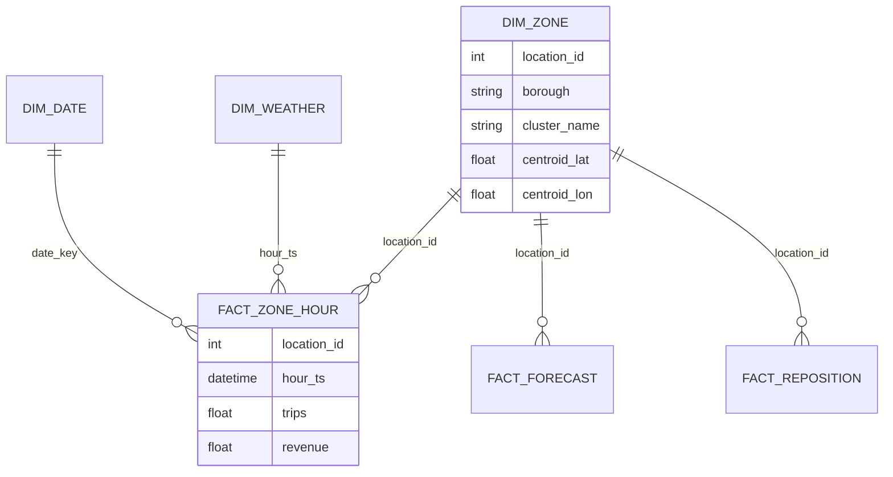

# Power BI data model

Load parquet (preferred) or CSV from `data/powerbi/`.

## Tables
| table | grain | role |
|---|---|---|
| fact_zone_hour | location_id × hour_ts | primary fact |
| fact_forecast | location_id × hour_ts | forecast fact (location_id 0 = citywide) |
| fact_reposition_recommendations | location_id × hour_ts (allocated rows) | decision fact |
| dim_zone | location_id | zone dimension + cluster + lat/long |
| dim_date | date_key | calendar + holiday |
| dim_weather | hour_ts | citywide weather |

## Relationships (star)

| from | to | cardinality | cross filter |
|---|---|---|---|
| fact_zone_hour[location_id] | dim_zone[location_id] | * : 1 | single |
| fact_zone_hour[date_key] | dim_date[date_key] | * : 1 | single |
| fact_zone_hour[hour_ts] | dim_weather[hour_ts] | * : 1 | single |
| fact_forecast[location_id] | dim_zone[location_id] | * : 1 | single (treat citywide 0 as unmatched or add a City row) |
| fact_reposition_recommendations[location_id] | dim_zone[location_id] | * : 1 | single |

Inactive alternative: relate forecast to date via `DATE(fact_forecast[hour_ts])` calculated column `forecast_date`.

